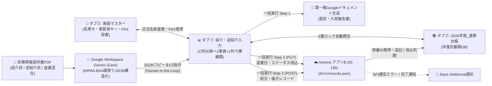
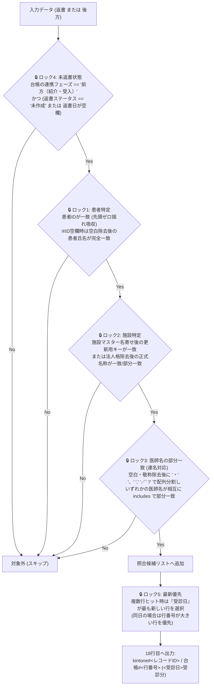

# 🏥 SANTE-BRIDGE 統合設計仕様書・運用マニュアル（Notion同期用ドラフト）

> **プロジェクト名**: SANTE-BRIDGE（サンテ溝上病院 地域連携・紹介返書管理＆第一報自動化システム）  
> **リポジトリ名**: `sante-bridge-liaison-hub`  
> **連携先kintoneアプリ**: アプリB（地域連携・紹介逆紹介管理台帳 / App ID: `195`）  
> **準拠ガイドライン**: 医療情報システムの安全管理に関するガイドライン（3省2ガイドライン） / Google Workspace HIPAA BAA

---

## 1. システム全体アーキテクチャとコンプライアンス設計

### 1.1 コンプライアンス前提（3省2ガイドライン・HIPAA BAA準拠）
1. **閉域AI OCR構造化**:
   - 紙の診療情報提供書（他院からの紹介状、当院医師作成の逆紹介状・返書が混在したスキャンPDF）は、外部のパブリックAPIへ直接送信せず、HIPAA BAA締結済みのGoogle Workspace標準「Gemini (Gem)」Web UI上でOCR・JSON構造化を実施する。
2. **Human-in-the-Loop（人間介在型ワークフロー）**:
   - 地域連携室スタッフがGemini出力JSONをスプレッドシート（ハブ）の `C2` セルにペーストすることで、`onEdit` トリガーにより1患者＝1列へ横展開・名寄せ・5重ロック照合が自動実行される。
   - スタッフが目視確認・加筆修正を行った上で「🚀 一括実行」を起動するため、OCR誤認識のままkintoneや第一報FAX文書へ反映されるリスクを排除する。
3. **秘匿情報の分離管理**:
   - kintone APIトークン・ドメイン・Slack Webhook URL・テンプレートDoc ID等の秘匿情報はソースコードやGitリポジトリに一切含めず、GASの `PropertiesService` (`ScriptProperties`) で一元管理する。

### 1.2 データフロー図

---

## 2. スプレッドシート3タブ構造定義

### 2.1 タブ①: `紹介・逆紹介入力`（フロントUI）
- **`C2:C3`**: Gemini抽出JSONペースト用セル（`onEdit` トリガー監視対象）
- **`B4` / `C4以降`**: `🔄 連携ステータス`（`⏳ 未連携` / `📄 第一報作成済（未連携）` / `✅ kintone反映済`）
- **`B5:B19`**: 項目ラベル（`C列` 以降に **1患者＝1列** として横展開）

| 行番号 | B列ラベル | データ型 / 入力規則 | 初期値・自動処理仕様 |
| :---: | :--- | :--- | :--- |
| **5** | `受診日` | 文字列 (`YYYY-MM-DD`) | JSONから抽出（未指定時は当日日付） |
| **6** | `患者ID` | 文字列 (`@`) | 先頭ゼロ保持のためテキスト書式適用 |
| **7** | `患者氏名` | 文字列 | 患者氏名 |
| **8** | `連携フェーズ` | プルダウン選択 | `前方（紹介・受入）` / `後方（逆紹介・送出）` / `返書（経過・結果報告）` / `その他（介護連携・対診）` |
| **9** | `受入・送出形態` | プルダウン選択 | `外来` / `入院` |
| **10** | `連携先施設名` | 文字列 | `施設マスター` と照合し **正式名称** へ自動変換 |
| **11** | `連携先診療科` | 文字列 | 紹介元／紹介先の診療科 |
| **12** | `連携先医師名` | 文字列 | 紹介元／紹介先の医師名（連名対応） |
| **13** | `当院担当診療科` | 文字列 | サンテ溝上病院の担当診療科 |
| **14** | `担当医師` | 文字列 | サンテ溝上病院の担当医師名 |
| **15** | `📝 第一報作成` | チェックボックス | `前方（紹介・受入）` かつ `入院` の場合は初期値 `TRUE`、`外来` 等は `FALSE`（手動変更可） |
| **16** | `🔗 報告書ドキュメント` | URL文字列 | 生成された第一報GoogleドキュメントのURLを自動出力 |
| **17** | `✅ FAX送信完了` | チェックボックス | スタッフが第一報FAX送信後にチェック（列クリア判定に使用） |
| **18** | `🎯 返書消込ターゲットID` | 文字列 | 5重ロック照合結果: `kintone#<レコードID> / 台帳#<行番号> (<受診日>受診分)` |
| **19** | `備考・連絡事項` | 文字列 | 備考・特記事項 |

### 2.2 タブ②: `2026年度_連携台帳`（年度別蓄積DB 兼 返書照合マスター）
- 日本の会計年度（4月1日〜翌3月31日）単位で自動生成・管理（例: `2026年度_連携台帳`、前年度分 `2025年度_連携台帳` も照合対象として自動参照）。

| 列 | カラム名 | 格納内容 |
| :---: | :--- | :--- |
| **A** | `kintoneレコードID` | kintone POST時に発番されたレコードID（`ids` 配列） |
| **B** | `登録日時` | 台帳追記日時 (`YYYY-MM-DD HH:mm:ss`) |
| **C** | `受診日` | 受診日・紹介日 (`YYYY-MM-DD`) |
| **D** | `患者ID` | 当院患者ID |
| **E** | `患者氏名` | 患者氏名 |
| **F** | `連携フェーズ` | `前方（紹介・受入）` / `後方（逆紹介・送出）` 等 |
| **G** | `受入・送出形態` | `外来` / `入院` |
| **H** | `更新用キー` | `施設マスター` から取得したルックアップキー |
| **I** | `連携先施設名` | 名寄せ後の正式施設名称 |
| **J** | `連携先診療科` | 相手先診療科 |
| **K** | `連携先医師名` | 相手先医師名 |
| **L** | `当院担当診療科` | 当院担当診療科 |
| **M** | `担当医師` | 当院担当医師 |
| **N** | `返書ステータス` | `前方` 初期値: `"未作成"` / 返書消込後: `"作成・送付完了"` / `後方` 初期値: `"対象外"` |
| **O** | `返書日` | 返書作成・消込実施日 (`YYYY-MM-DD`) |
| **P** | `第一報URL` | 生成された第一報GoogleドキュメントURL |
| **Q** | `FAX送信状況` | `"未送信"` / `"送信完了"` / `"不要"` |
| **R** | `備考・連絡事項` | 備考・特記事項 |

### 2.3 タブ③: `施設マスター`（名寄せ＆FAX番号辞書）
| 列 | カラム名 | 用途 |
| :---: | :--- | :--- |
| **A** | `更新用キー` | kintoneルックアップ用の一意キー（例: `FAC-0001`） |
| **B** | `正式名称` | 名寄せ変換後の正式医療機関名 |
| **C** | `住所` | 医療機関所在地 |
| **D** | `FAX番号` | 第一報ドキュメント `{{連携先FAX番号}}` に自動挿入されるFAX番号 |
| **E以降** | `略称・別名リスト` | OCRで出現し得る略称・旧称・表記揺れ（複数列およびカンマ区切り両対応） |

---

## 3. kintoneアプリB（App ID: 195）フィールドマッピング表

### 3.1 フィールドマッピング定義
| スプレッドシート項目 | 台帳列 | kintoneフィールドコード (デフォルト) | kintoneフィールド型 | POST時 (前方・後方) | PUT時 (返書消込) |
| :--- | :---: | :--- | :--- | :---: | :---: |
| `kintoneレコードID` | A列 | `$id` (レコード番号) | `RECORD_NUMBER` | レスポンス `ids` で取得 | 更新対象 `id` に指定 |
| `受診日` | C列 | `受診日` | `DATE` | ✅ 送信 | - |
| `患者ID` | D列 | `患者ID` | `SINGLE_LINE_TEXT` | ✅ 送信 | - |
| `患者氏名` | E列 | `患者氏名` | `SINGLE_LINE_TEXT` | ✅ 送信 | - |
| `連携フェーズ` | F列 | `連携フェーズ` | `DROP_DOWN` / `RADIO_BUTTON` | ✅ 送信 | - |
| `受入・送出形態` | G列 | `受入・送出形態` | `DROP_DOWN` / `RADIO_BUTTON` | ✅ 送信 | - |
| `更新用キー` | H列 | `更新用キー` | `SINGLE_LINE_TEXT` (Lookup) | ✅ マスター一致時送信 | - |
| `連携先施設名` | I列 | `連携先施設名` | `SINGLE_LINE_TEXT` | ✅ 送信 | - |
| `連携先診療科` | J列 | `連携先診療科` | `SINGLE_LINE_TEXT` | ✅ 送信 | - |
| `連携先医師名` | K列 | `連携先医師名` | `SINGLE_LINE_TEXT` | ✅ 送信 | - |
| `当院担当診療科` | L列 | `当院担当診療科` | `SINGLE_LINE_TEXT` | ✅ 送信 | - |
| `担当医師` | M列 | `担当医師` | `SINGLE_LINE_TEXT` | ✅ 送信 | - |
| `返書ステータス` | N列 | `返書ステータス` | `DROP_DOWN` | ✅ (`前方`=`"未作成"`) | ✅ `"作成・送付完了"` |
| `返書日` | O列 | `返書日` | `DATE` | 空欄 | ✅ 今回の日付で更新 |
| `第一報URL` | P列 | `第一報URL` | `LINK` / `SINGLE_LINE_TEXT` | ✅ 送信 | - |
| `FAX送信状況` | Q列 | `FAX送信状況` | `DROP_DOWN` | ✅ 送信 | - |
| `備考・連絡事項` | R列 | `備考・連絡事項` | `MULTI_LINE_TEXT` | ✅ 送信 | - |

### 3.2 連携フェーズ別のAPI挙動マトリクス
| 連携フェーズ | kintone新規POST (`/k/v1/records.json`) | 台帳への新規行追加 | kintone既存レコードPUT消込 (`18行目IDあり時`) | 台帳既存行の返書ステータス更新 |
| :--- | :---: | :---: | :---: | :---: |
| **`前方（紹介・受入）`** | ✅ 実行 (`返書ステータス: "未作成"`) | ✅ 最下行へ追記 | - | - |
| **`後方（逆紹介・送出）`** | ✅ 実行 (`返書ステータス: "対象外"`) | ✅ 最下行へ追記 | ✅ 18行目にターゲットIDがある場合は同時消込 | ✅ 該当行を `"作成・送付完了"` に更新 |
| **`返書（経過・結果報告）`** | ❌ **実行しない** | ❌ **追加しない** | ✅ **PUT消込更新のみ実行** | ✅ 該当行を `"作成・送付完了"` に更新 |
| **`その他（介護連携・対診）`** | ❌ 実行しない | ❌ 追加しない | - | - |

---

## 4. 5重ロック自動照合アルゴリズム設計書 (`src/LedgerMatcher.js`)

### 4.1 照合トリガーと検索範囲
- **発火タイミング**: `C2` セルへのJSONペースト時（またはメニュー「🔍 全列の5重ロック再照合」実行時）
- **対象データ**: `連携フェーズ` が `返書（経過・結果報告）` または `後方（逆紹介・送出）` の列
- **検索対象シート**: 当年度台帳（`2026年度_連携台帳`）および前年度台帳（`2025年度_連携台帳` が存在する場合）の全行

### 4.2 5重ロック判定ロジック詳細

#### ロック3（医師名連名・表記揺れ吸収）の具体例
- **台帳側（紹介受入時）**: `"田中 太郎・佐藤 次郎"` → 分割配列 `["田中太郎", "佐藤次郎"]`
- **返書側（経過報告時）**: `"佐藤先生"` → 敬称除去・分割配列 `["佐藤"]`
- **判定**: `"佐藤次郎".includes("佐藤") === true` となり、**連名紹介に対する単名宛て返書（またはその逆）でも確実にロック3を通過**する。

---

## 5. 地域連携室スタッフ向け 運用マニュアル

### Step 1: Gemini (Gem) でPDFからJSONを抽出
1. スキャンした診療情報提供書PDF（紹介状・逆紹介状・返書が混在していても可）をGoogle WorkspaceのGemini（地域連携用Gem）にアップロードし、出力されたJSONコードをコピーします。

### Step 2: スプレッドシート `C2` セルへペースト
1. `紹介・逆紹介入力` タブの `C2` セルを選択し、コピーしたJSONを貼り付けます。
2. 自動的に `C列` 以降へ1患者＝1列として横展開され、以下が自動セットされます：
   - **10行目 `連携先施設名`**: `施設マスター` に基づき正式名称へ自動変換
   - **15行目 `📝 第一報作成`**: `前方（紹介・受入）` かつ `入院` の場合は自動でチェックON（外来でも第一報を送る場合は手動でチェックON）
   - **18行目 `🎯 返書消込ターゲットID`**: `返書` や `後方` の場合、5重ロック照合でヒットした過去の紹介レコード（`kintone#123 / 台帳#45 (2026-10-15受診分)`）が自動表示

### Step 3: 目視確認と「🚀 一括実行」
1. 展開された内容を目視確認し、メニュー **「🏥 SANTE-BRIDGE 連携メニュー」＞「🚀 一括実行（第一報生成・kintone連携・台帳反映）」** をクリックします。
2. 以下の処理が一括で自動実行されます：
   - **第一報Googleドキュメント生成**: 16行目にドキュメントURLが出力されます。
   - **kintone新規登録 (POST) ＆ 台帳追記**: `前方`・`後方` のデータがkintone（App ID: 195）へ一括登録され、`2026年度_連携台帳` の最下行へ追記されます。
   - **kintone返書消込 (PUT) ＆ 台帳更新**: 18行目にターゲットIDがある列について、kintoneと台帳の双方で `返書ステータス: "作成・送付完了"`・`返書日` が自動更新されます。

### Step 4: FAX送信と完了列のクリア
1. 16行目のURLから第一報ドキュメントを開いて印刷・FAX送信したら、**17行目 `✅ FAX送信完了`** にチェックを入れます。
2. メニュー **「🧹 送信完了・処理済列のクリア整理」** を実行すると、FAX送信完了列および第一報不要のkintone連携済列がクリアされ、FAX未送信の列だけがC列から左詰めで残ります。
