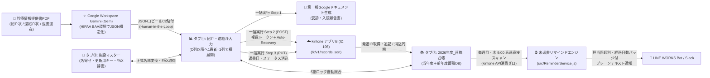

# 🏥 SANTE-BRIDGE 統合設計仕様書・運用マニュアル（Notion同期用ドラフト / Phase 2対応版）

> **プロジェクト名**: SANTE-BRIDGE（サンテ溝上病院 地域連携・紹介返書管理＆第一報自動化システム）  
> **バージョン**: `v2.0.0` (Phase 2)  
> **リポジトリ名**: `sante-bridge-liaison-hub`  
> **連携先kintoneアプリ**: アプリB（地域連携・紹介逆紹介管理台帳 / App ID: `195`）＋ 施設マスターアプリ（ルックアップ参照）  
> **準拠ガイドライン**: 医療情報システムの安全管理に関するガイドライン（3省2ガイドライン） / Google Workspace HIPAA BAA

---

## 1. システム全体アーキテクチャとコンプライアンス設計

### 1.1 コンプライアンス前提（3省2ガイドライン・HIPAA BAA準拠）
1. **閉域AI OCR構造化**:
   - 紙の診療情報提供書（他院からの紹介状、当院医師作成の逆紹介状・返書が混在したスキャンPDF）は、外部のパブリックAPIへ直接送信せず、HIPAA BAA締結済みのGoogle Workspace標準「Gemini (Gem)」Web UI上でOCR・JSON構造化を実施する。
2. **Human-in-the-Loop（人間介在型ワークフロー）**:
   - 地域連携室スタッフがGemini出力JSONをスプレッドシート（ハブ）の `C2` セルにペーストすることで、`onEdit` トリガーにより1患者＝1列へ横展開・名寄せ・5重ロック照合が自動実行される。
   - スタッフが目視確認・加筆修正を行った上で「🚀 一括実行」を起動するため、OCR誤認識のままkintoneや第一報FAX文書へ反映されるリスクを排除する。
3. **秘匿情報の分離管理 (`PropertiesService`)**:
   - kintone APIトークン（アプリB用＋施設マスタールックアップ用）・ドメイン・LINE WORKS Bot認証鍵（JWT RS256秘密鍵等）・Slack Webhook URL・テンプレートDoc ID等の秘匿情報はソースコードやGitリポジトリに一切含めず、GASの `PropertiesService` (`ScriptProperties`) で一元管理する。

### 1.2 データフロー図 (Phase 2)


---

## 2. スプレッドシート3タブ構造定義 ＆ UIスクロール固定仕様 (Phase 2)

### 2.1 タブ①: `紹介・逆紹介入力`（フロントUI）
- **UIスクロール固定（フリーズ）仕様**:
  - **行固定**: **`setFrozenRows(4)`** — 1〜4行目（JSON貼付枠 `C2:C3` および 4行目の連携ステータス行）を上部に常時固定。
  - **列固定**: **`setFrozenColumns(2)`** — A〜B列（項目ラベル列）を左側に常時固定し、C列以降に数十件横展開しても項目名を見失わない設計。
- **セル配置定義**:
  - **`C2:C3`**: Gemini抽出JSONペースト用セル（`onEdit` トリガー監視対象）
  - **`B4` / `C4以降`**: `🔄 連携ステータス`（`⏳ 未連携` / `📄 第一報作成済（未連携）` / `✅ kintone反映済`）
  - **`B5:B19`**: 項目ラベル（`C列` 以降に **1患者＝1列** として横展開）

| 行番号 | B列ラベル | データ型 / 入力規則 | 初期値・自動処理仕様 |
| :---: | :--- | :--- | :--- |
| **5** | `受診日` | 文字列 (`YYYY-MM-DD`) | JSONから抽出（未指定時は当日日付） |
| **6** | `患者ID` | 文字列 (`@`) | 先頭ゼロ保持のためテキスト書式適用 |
| **7** | `患者氏名` | 文字列 | 患者氏名 |
| **8** | `連携フェーズ` | プルダウン選択 | `前方（紹介・受入）` / `後方（逆紹介・送出）` / `返書（経過・結果報告）` / `その他（介護連携・対診）` |
| **9** | `受入・送出形態` | プルダウン選択 | `外来` / `入院` |
| **10** | `連携先施設名` | 文字列 | `施設マスター` と照合し **正式名称** へ自動変換 |
| **11** | `連携先診療科` | 文字列 | 紹介元／紹介先の診療科 |
| **12** | `連携先医師名` | 文字列 | 紹介元／紹介先の医師名（連名対応） |
| **13** | `当院担当診療科` | 文字列 | サンテ溝上病院の担当診療科 |
| **14** | `担当医師` | 文字列 | サンテ溝上病院の担当医師名 |
| **15** | `📝 第一報作成` | チェックボックス | `前方（紹介・受入）` かつ `入院` の場合は初期値 `TRUE`、`外来` 等は `FALSE`（手動変更可） |
| **16** | `🔗 報告書ドキュメント` | URL文字列 | 生成された第一報GoogleドキュメントのURLを自動出力 |
| **17** | `✅ FAX送信完了` | チェックボックス | スタッフが第一報FAX送信後にチェック（列クリア判定に使用） |
| **18** | `🎯 返書消込ターゲットID` | 文字列 | 5重ロック照合結果: `kintone#<レコードID> / 台帳#<行番号> (<受診日>受診分)` |
| **19** | `備考・連絡事項` | 文字列 | 備考・特記事項 |

### 2.2 タブ②: `2026年度_連携台帳`（年度別蓄積DB 兼 返書照合・未返書抽出マスター）
- **会計年度管理**: 日本の会計年度（4月1日〜翌3月31日）単位で自動生成・管理（例: `2026年度_連携台帳`、前年度分 `2025年度_連携台帳` も5重ロック照合および未返書リマインドで自動参照）。
- **UIスクロール固定 ＆ 条件付き書式仕様 (Phase 2強化)**:
  - **ヘッダー装飾 (`A1:R1`)**: 背景色 `#0F4C5C`（ディープティール）、文字色 `#FFFFFF`（白）、太字、中央揃え。
  - **行固定**: **`setFrozenRows(1)`**（1行目ヘッダー固定）。
  - **列固定**: **`setFrozenColumns(5)`**（A列〜E列「患者氏名」まで列固定。右へスクロールしても常に患者氏名を確認可能）。
  - **N列（`返書ステータス`）条件付き書式**:
    - 値が `"未作成"` のとき：背景色 `#F4CCCC`（淡赤色アラート）
    - 値が `"作成・送付完了"` のとき：背景色 `#D9EAD3`（淡緑色完了）

| 列 | カラム名 | 格納内容 |
| :---: | :--- | :--- |
| **A** | `kintoneレコードID` | kintone POST時に発番されたレコードID（`ids` 配列） |
| **B** | `登録日時` | 台帳追記日時 (`YYYY-MM-DD HH:mm:ss`) |
| **C** | `受診日` | 受診日・紹介日 (`YYYY-MM-DD`) |
| **D** | `患者ID` | 当院患者ID |
| **E** | `患者氏名` | 患者氏名（※この列まで横スクロール固定） |
| **F** | `連携フェーズ` | `前方（紹介・受入）` / `後方（逆紹介・送出）` 等 |
| **G** | `受入・送出形態` | `外来` / `入院` |
| **H** | `更新用キー` | `施設マスター` から取得したルックアップキー |
| **I** | `連携先施設名` | 名寄せ後の正式施設名称 |
| **J** | `連携先診療科` | 相手先診療科 |
| **K** | `連携先医師名` | 相手先医師名 |
| **L** | `当院担当診療科` | 当院担当診療科 |
| **M** | `担当医師` | 当院担当医師 |
| **N** | `返書ステータス` | `前方` 初期値: `"未作成"` (`#F4CCCC`) / 返書消込後: `"作成・送付完了"` (`#D9EAD3`) / `後方` 初期値: `"対象外"` |
| **O** | `返書日` | 返書作成・消込実施日 (`YYYY-MM-DD`) |
| **P** | `第一報URL` | 生成された第一報GoogleドキュメントURL |
| **Q** | `FAX送信状況` | `"未送信"` / `"送信完了"` / `"不要"` |
| **R** | `備考・連絡事項` | 備考・特記事項 |

### 2.3 タブ③: `施設マスター`（名寄せ＆FAX番号辞書）
| 列 | カラム名 | 用途 |
| :---: | :--- | :--- |
| **A** | `更新用キー` | kintoneルックアップ用の一意キー（例: `FAC-0001`） |
| **B** | `正式名称` | 名寄せ変換後の正式医療機関名 |
| **C** | `住所` | 医療機関所在地 |
| **D** | `FAX番号` | 第一報ドキュメント `{{連携先FAX番号}}` に自動挿入されるFAX番号 |
| **E以降** | `略称・別名リスト` | OCRで出現し得る略称・旧称・表記揺れ（複数列およびカンマ区切り両対応） |

---

## 3. kintoneアプリB（App ID: 195）実環境適合仕様 (`src/KintoneClient.js`)

### 3.1 ルックアップ参照元トークンのカンマ連結対応
- kintone REST APIでルックアップフィールド（`更新用キー`）を含むレコードをPOST/PUTする場合、アプリB（ID: 195）のAPIトークン（`KINTONE_API_TOKEN`）に加え、参照元である「医療機関・施設マスターアプリ」の閲覧権限を持つAPIトークン（`KINTONE_API_TOKEN_MASTER`）が必要となる。
- `getKintoneRequestContext()` にて `X-Cybozu-API-Token: ${KINTONE_API_TOKEN},${KINTONE_API_TOKEN_MASTER}` の形式でカンマ連結・重複排除して送信する。

### 3.2 `連携方向` フィールド互換性と未定義フィールド Auto-Recovery 機構
1. **`連携方向` (`DIRECTION`) / `連携フェーズ` (`PHASE`) の両対応**:
   - アプリBの既存フィールドコード `連携方向` との互換性を保つため、POSTペイロード生成時に `連携フェーズ` と `連携方向` の双方に `"前方（紹介・受入）"` または `"後方（逆紹介・送出）"` をセットする。
2. **未定義フィールドエラー自動除外リトライ（Auto-Recovery機能）**:
   - kintoneアプリB側に未作成の拡張フィールド（`第一報URL`, `FAX送信状況`, `返書ステータス`, `備考・連絡事項`, または `連携フェーズ` / `連携方向` の片方など）が原因で `GAIA_FC01` 等のエラーが返却された場合、`extractMissingFieldCodesFromError()` がエラーレスポンスから該当フィールドコードを自動抽出する。
   - 検知された未定義フィールドをペイロードから除外して即座に自動リトライ送信（最大8回）するため、kintone側のフィールド追加作業状況に依存せず安全にレコード登録・返書日PUT更新を完遂できる。

### 3.3 フィールドマッピング表
| スプレッドシート項目 | 台帳列 | kintoneフィールドコード | POST時 (`前方`・`後方`) | PUT時 (返書消込) | Auto-Recovery対象 |
| :--- | :---: | :--- | :---: | :---: | :---: |
| `kintoneレコードID` | A列 | `$id` | レスポンス `ids` で取得 | 更新対象 `id` に指定 | - |
| `受診日` | C列 | `受診日` | ✅ 送信 | - | ✅ |
| `患者ID` | D列 | `患者ID` | ✅ 送信 | - | ✅ |
| `患者氏名` | E列 | `患者氏名` | ✅ 送信 | - | ✅ |
| `連携フェーズ` | F列 | `連携フェーズ` / `連携方向` | ✅ 両セット（片方未定義時は自動除外） | - | ✅ |
| `受入・送出形態` | G列 | `受入・送出形態` | ✅ 送信 | - | ✅ |
| `更新用キー` | H列 | `更新用キー` (Lookup) | ✅ マスター一致時送信 | - | ✅ |
| `連携先施設名` | I列 | `連携先施設名` | ✅ 送信 | - | ✅ |
| `連携先診療科` | J列 | `連携先診療科` | ✅ 送信 | - | ✅ |
| `連携先医師名` | K列 | `連携先医師名` | ✅ 送信 | - | ✅ |
| `当院担当診療科` | L列 | `当院担当診療科` | ✅ 送信 | - | ✅ |
| `担当医師` | M列 | `担当医師` | ✅ 送信 | - | ✅ |
| `返書ステータス` | N列 | `返書ステータス` | ✅ (`前方`=`"未作成"`) | ✅ `"作成・送付完了"` | ✅ (未定義時は`返書日`のみPUT) |
| `返書日` | O列 | `返書日` | 空欄 | ✅ 今回の日付で更新 | - |
| `第一報URL` | P列 | `第一報URL` | ✅ 送信 | - | ✅ |
| `FAX送信状況` | Q列 | `FAX送信状況` | ✅ 送信 | - | ✅ |
| `備考・連絡事項` | R列 | `備考・連絡事項` | ✅ 送信 | - | ✅ |

---

## 4. 5重ロック自動照合アルゴリズム設計書 (`src/LedgerMatcher.js`)

- **対象データ**: `連携フェーズ` が `返書（経過・結果報告）` または `後方（逆紹介・送出）` の列
- **検索対象シート**: 当年度台帳（`2026年度_連携台帳`）および前年度台帳（`2025年度_連携台帳`）
- **5重ロック条件**:
  1. **ロック1（患者特定）**: `患者ID` が一致（先頭ゼロ揺れ吸収、ID空欄時はスペース除去後の `患者氏名` が一致）。
  2. **ロック2（施設特定）**: 名寄せ後の `更新用キー` または `連携先施設名`（法人格除去後）が一致／部分一致。
  3. **ロック3（医師名の「含む」部分一致・連名対応）**: スペース・敬称除去後、`・` `、` `,` `／` `/` で分割した配列同士を比較し、いずれかの医師名が `includes` で部分一致。
  4. **ロック4（未返書状態）**: 台帳側の `連携フェーズ` が `前方（紹介・受入）` であり、かつ `返書ステータス` が `未作成`（または `返書日` が空欄）。
  5. **ロック5（最新優先）**: 複数行ヒット時は `受診日` が最も新しい行を選択し、18行目に `kintone#<レコードID> / 台帳#<行番号> (<受診日>受診分)` を出力。

---

## 5. 未返書リスト抽出 ＆ LINE WORKS 定期リマインド仕様 (`src/ReminderService.js`)

### 5.1 設計方針（kintone API消費ゼロ・年度またぎ対応）
- `getCandidateLedgerSheets()` により、実行日基準の「当年度台帳（`2026年度_連携台帳`）」と「前年度台帳（`2025年度_連携台帳`）」を直接メモリ上で高速走査する。
- **未返書抽出条件**:
  1. F列 `連携フェーズ` が `"前方"` で始まる
  2. O列 `返書日` が空欄
  3. N列 `返書ステータス` が `"作成・送付完了"`・`"対象外"` ではない

### 5.2 経過日数バッジ判定と医師別グルーピング
- 実行日と C列 `受診日` の差分から経過日数を算出し、3段階のバッジを付与：
  - **`14日以上経過`**: `🚨`（至急・最優先フォロー）
  - **`7日〜13日経過`**: `⚠️`（医師への作成依頼タイミング）
  - **`7日未満`**: `📌`（直近受診・経過観察）
- M列 `担当医師`（空欄時は `"担当医未定"`）ごとにグルーピングし、各医師内で経過日数が長い順（古い受診日順）にソート。

### 5.3 LINE WORKS プレーンテキスト出力フォーマット例
LINE WORKS上でMarkdown記号（`*` 等）が露出しないよう、プレーンテキスト＋絵文字・罫線のみで整形：
```text
━━━━━━━━━━━━━━━━━━━━
📋 【地域連携室】紹介患者 返書未作成リマインド
集計日: 2026/10/29(木)
未作成合計: 3件（うち14日以上経過: 1件 / 7日以上経過: 2件）
━━━━━━━━━━━━━━━━━━━━
🚨:14日以上経過(至急) ⚠️:7〜13日経過 📌:7日未満

────────────────────
■ 溝上 太郎 先生（2件）
────────────────────
🚨 10/10受診(19日経過) [入院]
ID:001234 山田 太郎 様
紹介元: 医療法人 〇〇クリニック 田中 一郎先生

⚠️ 10/20受診(9日経過) [外来]
ID:005678 佐藤 花子 様
紹介元: △△病院 鈴木 次郎先生

────────────────────
■ 担当医未定（1件）
────────────────────
📌 10/26受診(3日経過) [外来]
ID:009012 高橋 健太 様
紹介元: □□医院 渡辺 三郎先生

━━━━━━━━━━━━━━━━━━━━
💡 作成済みの返書（経過・結果報告）または逆紹介状は、
スキャンしてGemini JSONをC2セルへ貼り付けると
5重ロック照合によりkintone・連携台帳から自動消込されます。
━━━━━━━━━━━━━━━━━━━━
```

---

## 6. 地域連携室スタッフ向け 運用マニュアル

1. **日常の入力・消込フロー**:
   - Gemini (Gem) で抽出したJSONを `紹介・逆紹介入力` タブの `C2` セルへ貼り付け → 内容を目視確認 → メニュー **「🚀 一括実行（第一報生成・kintone連携・台帳反映）」** を実行。
   - 第一報をFAX送信したら17行目 `✅ FAX送信完了` にチェック → メニュー **「🧹 送信完了・処理済列のクリア整理」** で完了列をクリア。
2. **未返書リマインド通知の運用**:
   - **定期自動通知**: メニュー **「⚙️ 初期設定・メンテナンス ＞ ⏰ 未返書リマインド定期トリガー設定（毎週月・木 9:00）」** を1回実行すると、毎週月曜・木曜の朝9時にLINE WORKS（およびSlack）へ未返書リストが自動通知されます。
   - **即時手動通知**: メニュー **「📢 未返書リストを今すぐ通知（LINE WORKS / Slack）」** からいつでも即時送信可能です。
